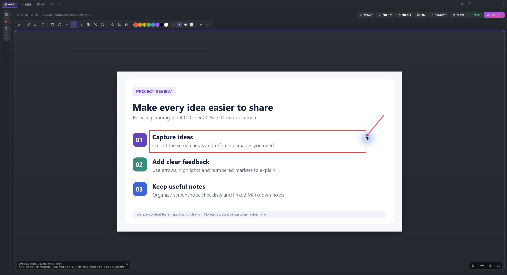
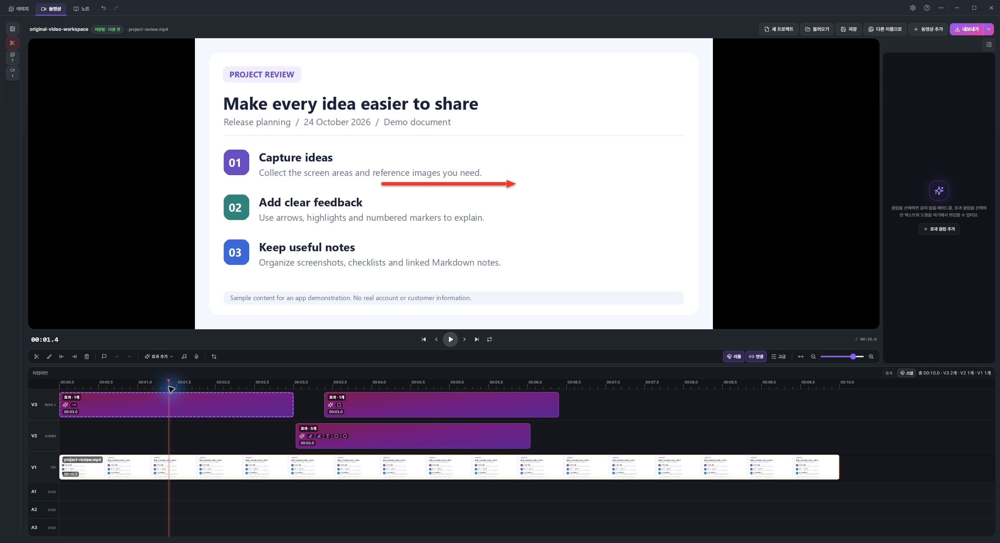
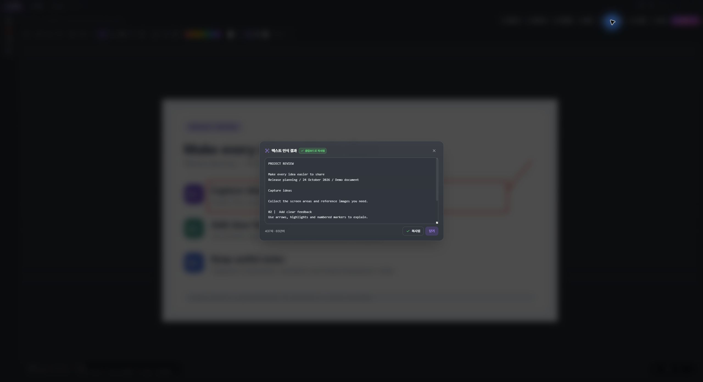
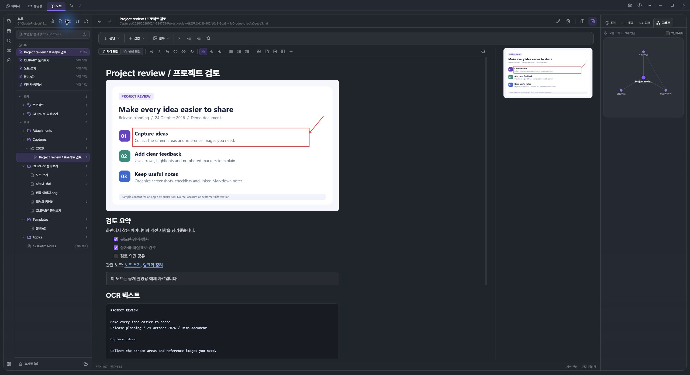

# CLIPARY — 캡처하고, 설명하고, 기록하세요

**한국어** · [English](README.en.md)

여러 장의 캡처를 한 장으로 합치고, 화살표로 설명하고, 화면을 녹화해 사용법 영상을 만들고, Markdown 노트로 보관하는 **무료 Windows 10/11 64비트 앱**입니다. 업무 피드백·버그 제보·매뉴얼·학습 자료 정리에 활용하세요.

**[Windows용 무료 다운로드](https://get.microsoft.com/installer/download/9NCFQVN0QZJC?referrer=appbadge&source=github.com)** · [소개·빠른 시작](https://selzystudio.github.io/Clipary-Releases/)

[영문 사용법·짧은 영상 3편](https://selzystudio.github.io/Clipary-Releases/guides/) — 캡처 설명, MP4·GIF 편집, OCR·Markdown 노트

## 설치 후 첫 캡처 · 3단계

1. CLIPARY를 설치하고 실행합니다.
2. `Ctrl+Shift+P`를 누르고 드래그로 영역을 고르거나 창을 클릭합니다.
3. 필요한 화살표·설명을 넣고 `Ctrl+Shift+C`로 복사한 뒤 문서에 `Ctrl+V`로 붙여넣습니다.

## 먼저 써볼 핵심 기능 · 활용도 순

### 1. 필요한 화면만 캡처하고 바로 공유

메신저로 질문하거나 업무 문서에 화면을 넣을 때, 영역·창을 골라 캡처하고 클립보드로 복사합니다. 지연 캡처와 마지막 영역 다시 캡처도 지원합니다.

1. Ctrl+Shift+P를 누릅니다.
2. 드래그로 영역을 고르거나 창을 클릭합니다.
3. 문서·메신저에서 Ctrl+V로 붙여넣습니다.

### 2. 화살표·번호·모자이크로 설명을 끝내기

버그 제보, 디자인 피드백, 업무 매뉴얼에 필요한 부분을 표시하세요. 화살표·텍스트·형광펜·도형·번호 마커·스포트라이트를 넣고, 공유 전 모자이크로 가릴 부분을 직접 선택합니다.

1. 캡처나 이미지 파일을 편집 화면에서 엽니다.
2. 화살표·텍스트·번호를 넣고 필요한 부분을 가립니다.
3. Ctrl+S로 저장하거나 Ctrl+Shift+C로 복사합니다.

### 3. 긴 웹페이지·대화 캡처를 한 장으로

여러 장으로 나뉜 기사·문서·대화·대시보드를 한 장으로 보관하세요. 자동 정합, 세로 스크롤, 가로 스크롤 모드와 겹침 없는 가로·세로 이어붙이기를 제공합니다.

1. 페이지를 직접 스크롤하며 인접 화면이 20~40% 겹치게 캡처합니다.
2. 이미지 목록의 순서를 맞추고 합성 모드를 고릅니다.
3. N장 합치기를 누른 뒤 결과를 저장합니다.

### 4. 화면을 녹화하고 MP4·GIF 사용법 영상으로

말로 설명하기 어려운 조작 과정을 영상으로 보여주세요. 모니터·창·영역 녹화 후 타임라인에서 자르고, 화살표·말풍선·강조·가리기·번호 효과와 보이스오버를 넣을 수 있습니다. MP4 해상도·화질·목표 크기와 GIF 크기·프레임 속도를 조절합니다.

1. 상단 녹화에서 모니터·창·영역을 선택하고 시작합니다.
2. 정지 후 편집기에서 Ctrl+B로 나누고 Q/W로 앞뒤를 다듬습니다.
3. 효과 추가로 안내를 넣고 내보내기에서 MP4 또는 GIF를 고릅니다.

### 5. 다시 타이핑하지 않고 이미지 글자 추출

이미지 속 한글·영문을 내장 OCR로 읽어 복사하세요. 캡처한 오류 메시지, 문서 일부, 학습 자료에서 텍스트를 꺼낼 때 유용합니다. 내장 OCR은 PC에서 처리하며 인식 결과는 수정할 수 있습니다.

1. 결과 이미지에서 텍스트 인식을 엽니다.
2. 내장 OCR을 선택해 실행합니다.
3. 결과를 확인·수정하고 복사하거나 메모에 저장합니다.

### 6. 캡처를 잊지 않도록 Markdown 노트로

캡처·설명·OCR 결과를 한 노트에 모으고 폴더·태그·토픽·검색으로 다시 찾으세요. [[노트 링크]], 백링크, 나란히 보기, 오늘 노트와 템플릿을 지원합니다. 일반 Markdown 폴더로 저장하며 Obsidian 보관함과 함께 사용할 수 있습니다.

1. 이미지 결과 화면의 메모를 누릅니다.
2. 제목·내용을 적고 필요하면 OCR 결과를 함께 저장합니다.
3. 노트 탭에서 검색하거나 관련 노트를 링크로 연결합니다.

### 7. 비교 이미지·콜라주를 한 페이지에 배치

전후 비교, 제품 이미지, 여러 단계의 안내 화면을 빈 캔버스에 배치하세요. 이미지 이동·크기 조절·회전, 배경·여백·투명 배경과 해상도 프리셋으로 공유할 한 장을 구성합니다.

1. 이미지 파일을 끌어 놓거나 파일 선택으로 추가합니다.
2. 단순 합치기를 열고 캔버스 크기·배경·여백을 정합니다.
3. 이미지를 배치하고 설명을 더한 뒤 저장합니다.

### 8. 필요할 때만 외부 AI로 캡처 정리

선택형 AI 정리로 캡처 내용을 한국어 Markdown 메모로 요약할 수 있습니다. Claude Code·Codex CLI·Gemini CLI의 별도 설치·로그인이 필요하며, 전송 전 확인 후 선택한 이미지·지시문을 해당 제공자에게 보냅니다.

1. 설정의 AI에서 사용할 제공자의 도구와 계정을 연결합니다.
2. 이미지의 AI 정리를 선택하고 전송 내용을 확인합니다.
3. 결과를 검토·수정한 뒤 메모에 저장합니다.

## 알아두면 편한 기본 단축키

| 기본 단축키 | 동작 |
|---|---|
| `Ctrl+Shift+P` | 영역·창 캡처 |
| `Ctrl+F12` | 기본 모니터 녹화 시작·중지 |
| `Ctrl+F11` | 마지막 영역 녹화 시작·중지 |
| `Ctrl+S` / `Ctrl+Shift+C` | 결과 이미지 저장·복사 |
| `Ctrl+B` / `Q` / `W` | 영상 나누기·앞뒤 다듬기 |
| `F1` | 앱 안 도움말 열기 |

단축키는 설정에서 바꿀 수 있습니다. 스크롤 캡처는 사용자가 페이지를 직접 스크롤하며 겹치게 찍은 뒤 합치는 방식입니다. 결과는 겹침·내용·배율에 따라 달라집니다. OCR 인식 결과와 가린 부분은 공유 전에 확인하세요.

## 무료 사용과 선택형 외부 AI

캡처·합성·일반 편집·녹화·내장 OCR·노트는 PC에서 처리하며 구매나 후원 없이 사용할 수 있습니다. 외부 AI만 별도 계정·도구와 제공자 조건·비용이 적용될 수 있고, 사용자가 확인한 뒤 선택한 내용을 전송합니다. AI 정리 결과는 현재 한국어 Markdown입니다. 앱 UI는 한국어·영어·일본어·중국어 간체를 지원합니다.

이 공개 저장소에는 설치 파일·안내·제3자 대응 소스만 제공합니다. **CLIPARY 앱 자체 소스는 비공개입니다.**

## 다운로드

### 기본 다운로드

**[Windows용 무료 다운로드 — Microsoft 공식 웹 설치기](https://get.microsoft.com/installer/download/9NCFQVN0QZJC?referrer=appbadge&source=github.com)**

Microsoft가 서명한 웹 설치 프로그램을 Microsoft 서버에서 받습니다. 실행하면 인터넷을 통해 Store 버전의 CLIPARY를 내려받아 설치하며, 이후 업데이트는 Microsoft Store가 관리합니다.

[Microsoft Store 소개 페이지](https://apps.microsoft.com/detail/9NCFQVN0QZJC?hl=ko-KR&gl=KR) · [공식 안내 사이트](https://selzystudio.github.io/Clipary-Releases/)

### 보조 다운로드

[GitHub 직접 설치 파일 — CLIPARY 1.0.1](https://github.com/SelzyStudio/Clipary-Releases/releases/tag/v1.0.1)

GitHub용 직접 설치 파일은 별도 Authenticode 인증서로 서명하지 않아 Windows의 게시자/SmartScreen 경고가 나타날 수 있습니다. 설치 파일의 SHA256을 릴리스의 SHA256SUMS.txt와 비교할 수 있습니다. GitHub 버전의 앱 자동 업데이트는 별도의 Tauri 전자서명을 검증합니다.

다운로드와 일반 기능에 구매·후원·라이선스 키를 요구하지 않습니다. 외부 AI는 선택 사항이며 별도 CLI·로그인 및 제공자 조건·비용이 적용될 수 있습니다.

## 개발 응원

- [Ko-fi](https://ko-fi.com/selzystudio) — 해외 일회성 후원
- [후원 안내](https://selzystudio.github.io/Clipary-Releases/support.html) — Ko-fi·카카오페이 선택

앱 정보·설정 화면의 기존 후원 경로는 처음부터 사용할 수 있습니다. 설정 옆 추가 후원 버튼은 **실제 사용한 날이 누적 3일**이 된 뒤 표시됩니다. GitHub Sponsors는 공개 페이지 준비 완료 후 추가합니다.

후원 여부와 금액에 따라 기능·이용 기간·광고 표시가 달라지지 않습니다. 소스 공개, 특정 업데이트 또는 우선 지원을 대가로 약속하지 않습니다. Microsoft는 후원을 모집하거나 주관하지 않습니다.

## 제3자 구성요소와 개인정보

[대응 소스·빌드 자료](https://github.com/SelzyStudio/Clipary-Releases/releases/tag/v1.0.0-sources)에는 자체 빌드한 FFmpeg·Hugin·Tesseract와 관련 라이브러리의 원본 소스, 패치, 설정·빌드 지침, 원문 고지가 있습니다. 필요한 고지와 MPL 소스는 설치 파일에도 포함합니다. 각 구성요소의 소스 제공·수정·재배포 권리는 해당 라이선스를 따르며 CLIPARY 자체의 비공개 방침에 의해 제한되지 않습니다.

[이용약관](https://selzystudio.github.io/Clipary-Releases/legal/terms.html) · [개인정보처리방침](https://selzystudio.github.io/Clipary-Releases/legal/privacy.html) · [후원·환불 안내](https://selzystudio.github.io/Clipary-Releases/legal/refund.html)

일반 작업은 PC에서 처리하고, 외부 AI는 사용자의 확인 후 선택한 이미지·지시문을 제공자에게 전달합니다. 문의 이메일·첨부는 해결 후 90일 이내 삭제하며 법정 보관 기록은 예외입니다.

## 문의

[Issues](https://github.com/SelzyStudio/Clipary-Releases/issues) · [selzystudio@gmail.com](mailto:selzystudio@gmail.com)

공개 이슈에 개인정보, 원본 업무 자료, 인증 정보나 민감한 캡처를 올리지 마세요.
